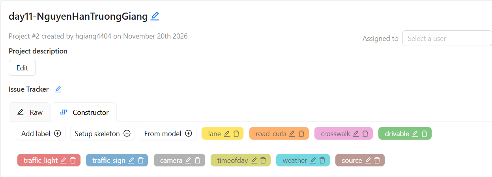
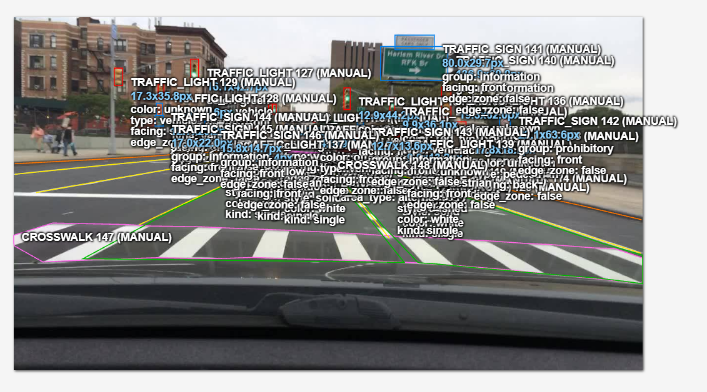
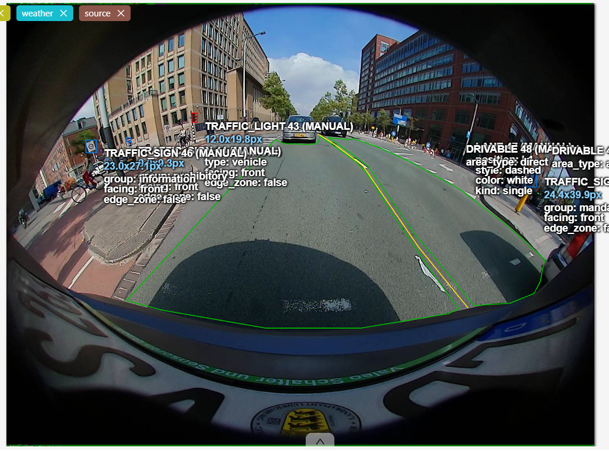
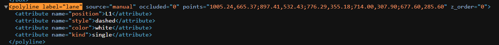

# Báo cáo cá nhân — Ngày 11

**Họ tên** Nguyễn Hàn Trương Giang  
**Mã học viên** 2A202603112  
**Phiên bản CVAT (Help → About)** 2.8.1
**Guideline** Road v1.0  
**Lần nộp (`revision` trong manifest)** 1  
**Thời điểm export trên CVAT** 22h00  
**Số lần nộp lại sau Rework** 0 lần 

## 1. Kiểm project

| Mục | Đúng như guideline Road v1.0? | Ghi chú |
| --- | --- | --- |
| 6 label, đúng kiểu | Có, theo kết quả kiểm file export | `lane` và `road_curb` dùng polyline. `crosswalk` và `drivable` dùng polygon. `traffic_light` và `traffic_sign` dùng rectangle. |
| Thuộc tính và giá trị | Đúng định dạng theo lint | Checker đọc được nhãn và thuộc tính trong hai ZIP. |
| 4 tag ảnh | Có, theo kết quả lint | Cả 20 ảnh có `camera`, `timeofday`, `weather` và `source`. Checker không báo tag camera sai so với tên ảnh. |

**Cách kết thúc polyline** Chọn **Polyline → lane → Shape**, đặt điểm từ gần xe ra xa rồi nhấn **N**.

**Cách đặt tag ảnh** Dùng công cụ **Tag** để đặt `camera` trước, sau đó đặt `timeofday`, `weather` và `source`. Kiểm tra `value` của từng tag trong **Objects → Details**.

## 2. Số lượng đã gán

| Task | Ảnh | lane | road_curb | crosswalk | drivable | traffic_light | traffic_sign |
| --- | ---: | ---: | ---: | ---: | ---: | ---: | ---: |
| front | 12 | 33 | 9 | 8 | 22 | 40 | 34 |
| front-extra (0 / 4) | 0 | 0 | 0 | 0 | 0 | 0 | 0 |
| fisheye | 8 | 8 | 0 | 10 | 11 | 6 | 4 |
| fisheye-extra (0 / 4) | 0 | 0 | 0 | 0 | 0 | 0 | 0 |
| **Tổng** | **20** | **41** | **9** | **18** | **33** | **46** | **38** |

Tổng cộng **185 shape** trong hai file export.

## 3. Bảng ca khó

Không có ca khó trong quá trình gán nhãn.

## 4. Phiếu QC 1 nhận được

**Bạn kiểm lô của tôi** Chưa ghi nhận.  
**Quyết định nhận được** Chưa có kết quả QC 1 cho lô của em.

| Mã lỗi | Số lỗi | Đồng ý? | Đã sửa? |
| --- | --- | --- | --- |
| Chưa có phiếu QC 1 cho lô của em | — | — | — |

**Phiếu QC 1 em thực hiện cho Nguyễn Văn Hòa** Em kiểm 6 ảnh gồm A02, A05, A09, B02, B04 và B06, tổng cộng 56 nhãn. Em ghi nhận **7 lỗi chính (12,5%)** và quyết định **Rework**. Hai trường hợp ở A05 và A09 được ghi riêng để xác minh trước khi tính lỗi thiếu vạch `L1` hoặc `R1`.

## 5. Kiểm file export

| File | Mở lại được? | Số shape ảnh 1 (job / file) | Số shape ảnh 2 (job / file) | Tag camera có trong XML? |
| --- | --- | --- | --- | --- |
| `nguyenhantruonggiang-front.zip` | Có, đọc được qua `lint` | A01 · chưa đối chiếu job / **10** | A02 · chưa đối chiếu job / **6** | Có, `front` |
| `nguyenhantruonggiang-fisheye.zip` | Có, đọc được qua `lint` | B01 · chưa đối chiếu job / **3** | B02 · chưa đối chiếu job / **7** | Có, B01 và B02 đều là `fisheye_front` |

`road_check lint` đọc đủ **20 ảnh** và tạo `nguyenhantruonggiang-manifest.json` với `revision 1`. Log của lô em ghi **21 cảnh báo tự động**, gồm 6 nặng, 7 chính và 8 nhẹ.

## 6. Ảnh chụp màn hình

1. Tab **Labels** của project

2. Ảnh **A08** trên CVAT, hiển thị nhãn làn, vùng lái và đèn/biển 

3. Ảnh **B03** trên CVAT, phóng to đoạn polyline

4. Đoạn XML có `<polyline label="lane">` trong `annotations.xml` của ZIP front 

## 7. Tự đánh giá

`QC1-02` là cảnh báo xuất hiện nhiều nhất trong log tự kiểm của em. Ở Ngày 20, em sẽ xác định ranh giới trái và phải của làn xe trước khi vẽ, rồi kiểm lại `position` của từng polyline trong **Details**. Khi ảnh không thấy vạch, em sẽ ghi mã ảnh và lý do để người kiểm đối chiếu.

Trong mô hình nhận diện làn theo hàng neo, polyline cung cấp tọa độ `x` của vạch tại các hàng `y` cố định. Nếu một vạch `R1` bị gán thành `L2`, tọa độ của nó có thể bị đưa vào đích huấn luyện của vạch bên trái, đồng thời đích của vạch phải có thể bị ghi là thiếu. Đây là lý do cần kiểm `position` ngay cả khi đường vẽ đã bám đúng vệt sơn. Bản export hiện tại chưa có kết quả xác nhận sau sửa.

## 8. Từ polyline đến đích row-anchor (tùy chọn)

Chưa thực hiện.